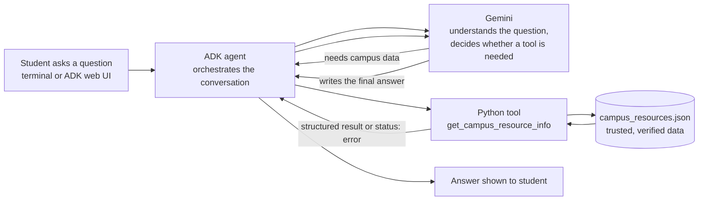

# Design Notes: Campus Resource Assistant

**Author:** Rebecca Russo
**Course:** CSC 2560 Introduction to AI Development, Agent Lab Part 2

## System Workflow

## Design Worksheet

### 1. The problem
The Office of Student services found that students were struggling with finding what campus resources exist and where to find them, since resources are scattered in different areas all over the JCC site.  They asked us to build a Campus Resource Assistant, a simple AI application where students can find the information they're looking for by asking a plain question such as "Where is tutoring?" and get an accurate, sourced answer. Starting small with the first version to demonstrate the core idea, then we will work on a public web version later on.

### 2. Why Gemini can't answer campus-specific questions alone
Gemini is trained on public information, not on the college's local and frequently changing details.  This includes: office hours, room numbers and phone numbers. Without a tool it might refuse, try to look the answer up, or confidently make up a seemingly correct but wrong answer (also known as a hallucination). The agent's tool gives it a trusted source, that way Gemini only has to understand the question and present the result.

### 3. Why the data lives in a JSON file instead of inside the Python function
1. **Separates data from logic.** Someone can update office hours without reading or editing Python.
2. **Independently reviewable.** An instructor, classmate or Student Services can verify the data without understanding code.
3. **Prepares for growth.** The JSON file can later be swapped for a database, live API or CMS without changing the agent logic.
4. **Easy to track.** It is human-readable, editable in VS Code and versioned in Git.

### 4. Three limitations and how to improve them
1. **The data can become stale.** Hours and rooms change often. Improvement: keep `last_verified` dates, re-check against the college website on a schedule, update `last_verified` dates,  and later on we will pull from a live feed.
2. **The model may sometimes fail to call the tool.** LLM behavior is random and uncertain at times. Improvement: strengthen the tool docstring and agent instructions, run lots of test questions, including boundary tests.
3. **The system is only as trustworthy as its source data.** The model returns whatever the JSON says. Improvement: require a human verification step for every resource, as well as have the tool return `status: "error"` instead of inventing data.

### 5. If the JSON data is inaccurate
Accurate data is of the highest importance to help students succeed with given resources and not waste valuable time with misinformation. A student could go to the wrong building, show up when the office is closed, or call a wrong number. They could miss a financial aid or advising deadline, and they would lose trust in the assistant and in Student Services. Because the agent states the data confidently, wrong data is worse than no data. The person who confirms each record (the `verified_by` field) is responsible for its accuracy. Student Services staff or the office that owns the resource should review it periodically.

## Campus Resources (research table)

Sources: official SUNY JCC pages, collected by the group on the Agent Lab discussion board. Where a field was not listed, it says "Not listed".

| Resource | Location | Hours | Phone | Email | Website | Verified By | Date Verified |
|---|---|---|---|---|---|---|---|
| Library (Hultquist Library) | Jamestown Campus: Hultquist Library, 525 Falconer Street, Jamestown. Cattaraugus County Campus: Library, 260 North Union Street, Olean | Fall 2026 - Jamestown: Mon-Thu 8 AM-6 PM, Fri 8 AM-4 PM. Cattaraugus County: Mon-Thu 8 AM-4 PM, Fri 8 AM-1 PM. Closed weekends (holiday and break exceptions apply) | 716.338.1008 (Jamestown), 716.376.7517 (Cattaraugus County) | Not listed | https://www.sunyjcc.edu/support/learning-commons/library | Rebecca Russo | 2026-10-08 |
| Learning Center (Tutoring) | Jamestown Campus: HULT Floor 1, Learning Commons. Cattaraugus County Campus: LLAC Floor 1, Learning Commons | Contact office for hours | 716.338.1008 (Jamestown), 716.376.7517 (Cattaraugus County) | Not listed | https://www.sunyjcc.edu/support/learning-commons/learning-center | Rebecca Russo | 2026-10-01 |
| Success Center (Advising and Counseling) | Jamestown Campus: COCE Floor 1. Cattaraugus County Campus: COLL Floor 1 | Contact office for hours | 716.338.1065 (Jamestown/Online), 716.376.7508 (Cattaraugus County) | successcenter@mail.sunyjcc.edu | https://sunyjcc.edu/support/counseling/staff | Rebecca Russo | 2026-10-01 |
| Financial Aid and Billing | Jamestown Campus: COCE Floor 1. Cattaraugus County Campus: COLL Floor 1 | Contact office for hours | 716.338.1009 | FinancialAid@sunyjcc.edu | https://www.sunyjcc.edu/support/financial-aid-billing/scholarships | Maryam Fatima | 2026-09-29 |
| Campus Bookstore | JCC Campus Store, 525 Falconer Street, Jamestown, NY 14701 | Mon-Thu: 9:00 AM-4:30 PM. Fri: 9:00 AM-2:00 PM. Sat-Sun: Closed | (716) 338-1186 | sm8369@bncollege.com | https://sunyjcc.bncollege.com/ | Rebecca Russo | 2026-10-08 |
| Campus Safety | Jamestown Campus: Collegiate Center (Hamilton Collegiate Center), Human Resources suite, 525 Falconer St., Jamestown, NY 14701 | Contact office for hours. Evenings and weekends: buildings and grounds, 716.490.0415 | 716.338.1015 | Not listed | https://www.sunyjcc.edu/support/safety | Rebecca Russo | 2026-10-08 |
| Career Services | Jamestown Campus and Cattaraugus County Campus | Contact office for hours | 716.338.1061 (Jamestown), 716.376.7584 (Cattaraugus County) | Not listed | https://www.sunyjcc.edu/support/career-services/interest | Rebecca Russo | 2026-10-08 |
